<div align="center">

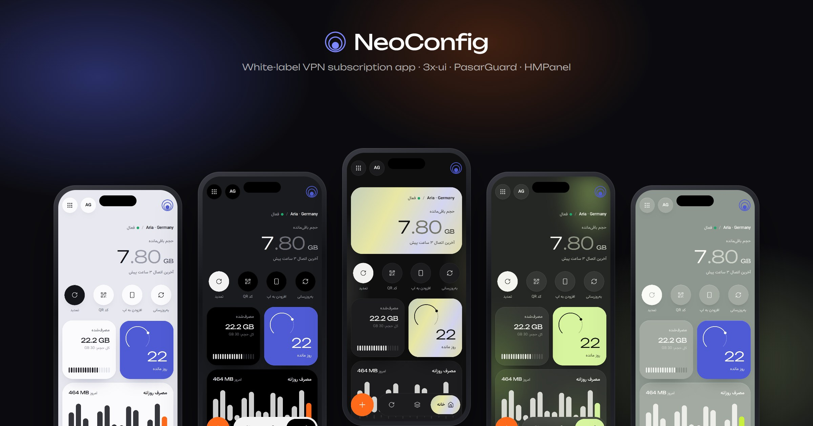

<h1>NeoConfig</h1>

**اپ اشتراک VPN با برند خودتان** — کاربر لینکش را می‌چسباند و حجم، روز، اتصال و تمدید را در یک اپ موبایلی تمیز می‌بیند.

**Your brand's own VPN subscription app** for 3x-ui, PasarGuard and HMPanel — installable, multi-brand, with card-to-card renewal.

<p>
  <a href="https://github.com/neoauroraproject/NeoConfig/releases/latest"></a>
  
  
  
</p>

<p>
  <a href="#-نصب-در-یک-دقیقه">نصب</a> ·
  <a href="#-پوسته‌ها">پوسته‌ها</a> ·
  <a href="#-اپ-کاربر">اپ کاربر</a> ·
  <a href="#-پنل-مدیریت">پنل مدیریت</a> ·
  <a href="#-hmpanel">HMPanel</a> ·
  <a href="#-فنی">فنی</a>
</p>

</div>

<br />

<div dir="rtl">

## ✦ چرا NeoConfig؟

<table>
<tr>
<td width="33%" valign="top">

### 🎨 برند خودتان
هر نماینده یک اپ با نام، لوگو، رنگ، دامنه و SSL خودش. پنج پوستهٔ آماده، متن‌های قابل ویرایش و نصب روی صفحهٔ اصلی گوشی.

</td>
<td width="33%" valign="top">

### ⚡ تمدید بی‌دردسر
کارت به کارت ← رسید ← تأیید با یک لمس در ربات تلگرام. حجم و روز همان لحظه روی پنل اضافه می‌شود و کاربر اعلان می‌گیرد.

</td>
<td width="33%" valign="top">

### 🔌 به پنل خودتان وصل
ثنایی (۲.x و ۳.x، با HWID)، پاسارگارد و HMPanel — با فروشگاه، کارت‌ها، دسته‌بندی‌ها و ربات HMPanel.

</td>
</tr>
</table>

## ◐ پوسته‌ها

پنج پوسته، هر کدام با لوگوی مناسب خودش (لوگوی تیره برای مه، لوگوی روشن برای بقیه). برند پیش‌فرض را انتخاب می‌کند و می‌تواند اجازه دهد کاربر از منو عوض کند.

<table>
<tr>
<td align="center">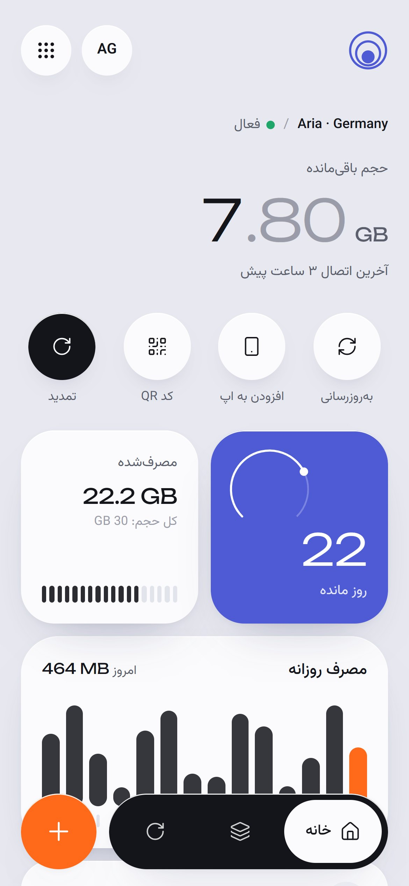<br /><b>مه</b> · Mist</td>
<td align="center">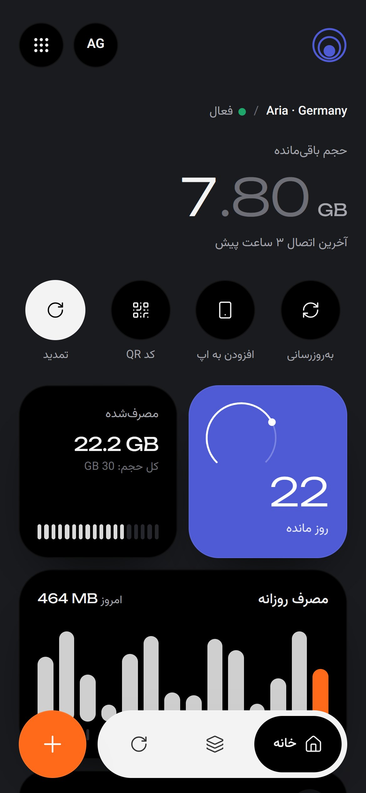<br /><b>گرافیت</b> · Graphite</td>
<td align="center">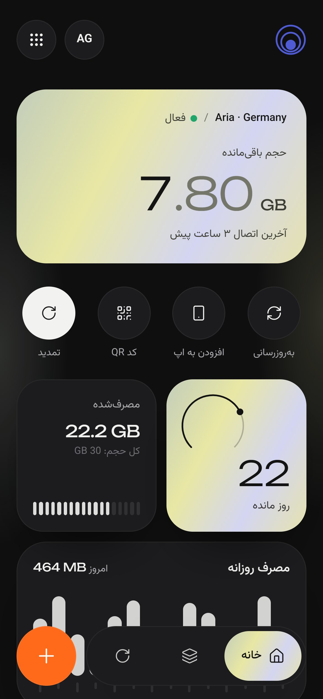<br /><b>مروارید</b> · Pearl</td>
<td align="center">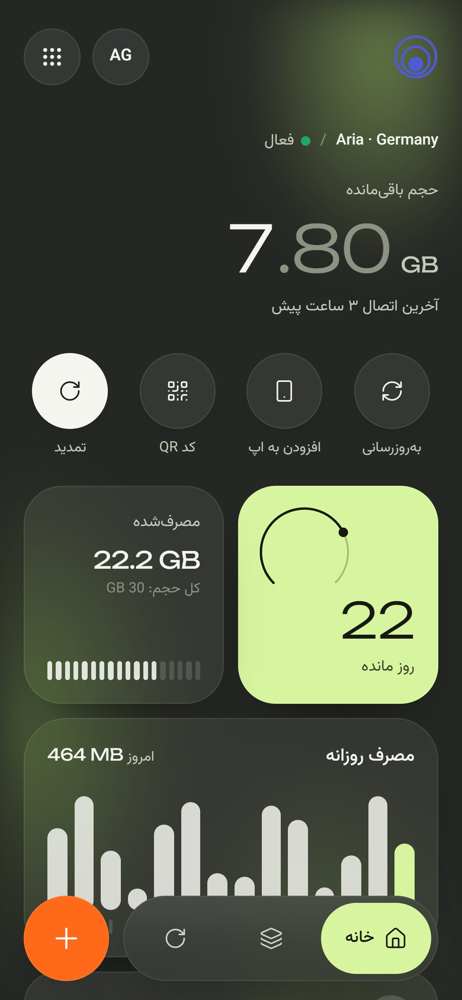<br /><b>خزه</b> · Moss</td>
<td align="center">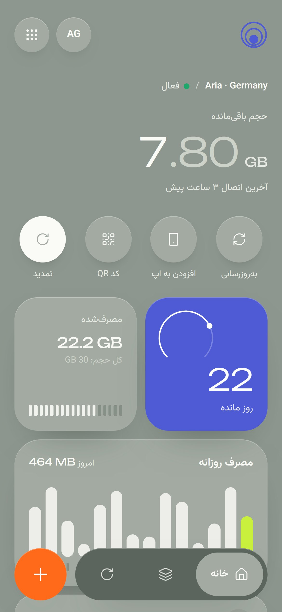<br /><b>مریم‌گلی</b> · Sage</td>
</tr>
</table>

## ◎ اپ کاربر

<table>
<tr>
<td align="center">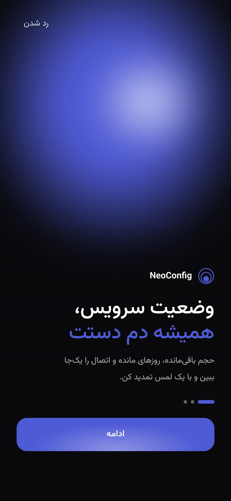<br />معرفی و راهنمای نصب</td>
<td align="center">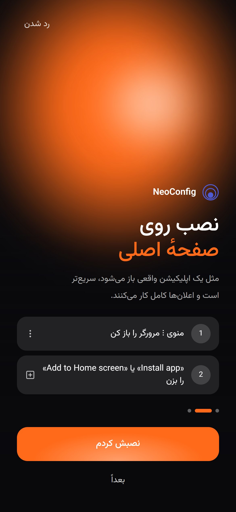<br />نصب روی آیفون / اندروید</td>
<td align="center"><br />افزودن با چسباندن لینک</td>
<td align="center">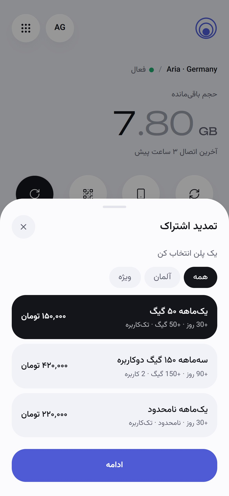<br />تمدید کارت به کارت</td>
<td align="center">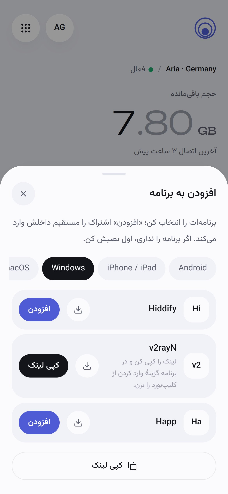<br />افزودن به V2Box، Hiddify…</td>
</tr>
</table>

- **یک فیلد برای شروع** — لینک اشتراک را می‌چسباند (چسباندن خود گوشی) و تمام؛ چند اشتراک روی یک دستگاه
- **همه‌چیز در یک نگاه** — حجم باقی‌مانده، روزهای مانده، آخرین اتصال، کاربر مجاز و دستگاه‌های متصل (HWID ثنایی ۳.۷+)
- **مصرف روزانه** — سرور هر روز ثبت می‌کند، حتی وقتی اپ بسته است
- **افزودن به برنامه** — لینک مستقیم برای V2Box، v2rayNG، Hiddify، Happ، Streisand، Shadowrocket و…؛ کد QR برای دستگاه دیگر
- **تمدید و خرید جدید** — پلن (با دسته‌بندی و نوع سرویس) ← کارت به کارت ← رسید ← پیگیری؛ علت رد و دکمهٔ پشتیبانی
- **اعلان حتی وقتی اپ بسته است** — نزدیک انقضا، روز آخر، ۱۰٪ حجم، تمام شدن حجم، و نتیجهٔ تمدید
- **حس اپ واقعی** — PWA، کشیدن برای تازه‌سازی، بدون زوم و پرش، داده‌های زنده؛ باز شدن خودکار در Safari/Chrome از داخل برنامه‌های دیگر
- **فارسی و انگلیسی**، راست‌به‌چپ کامل، فونت وزیرمتن

<p align="center">
  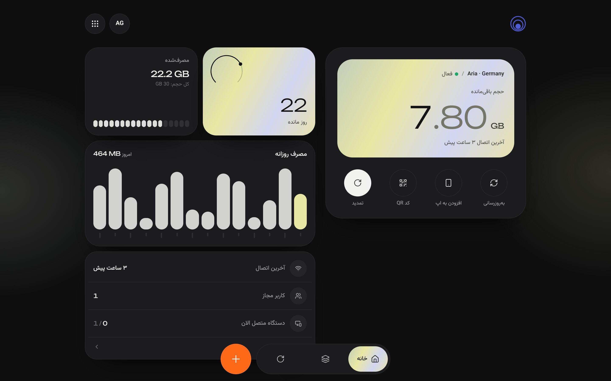
  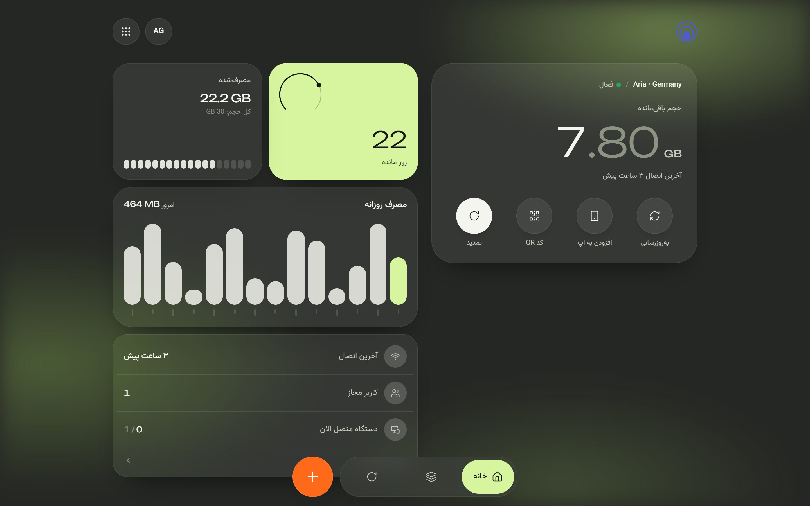
</p>
<p align="center"><sub>روی دسکتاپ، همان طراحی دوستونه و عریض می‌شود.</sub></p>

## ▤ پنل مدیریت

<p align="center">
  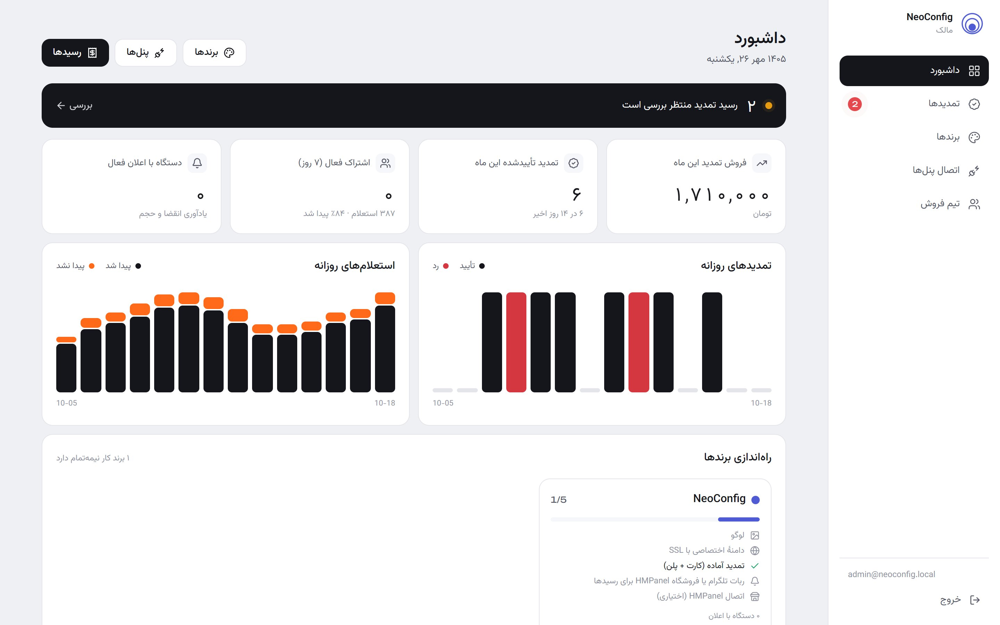
</p>

<table>
<tr>
<td width="50%">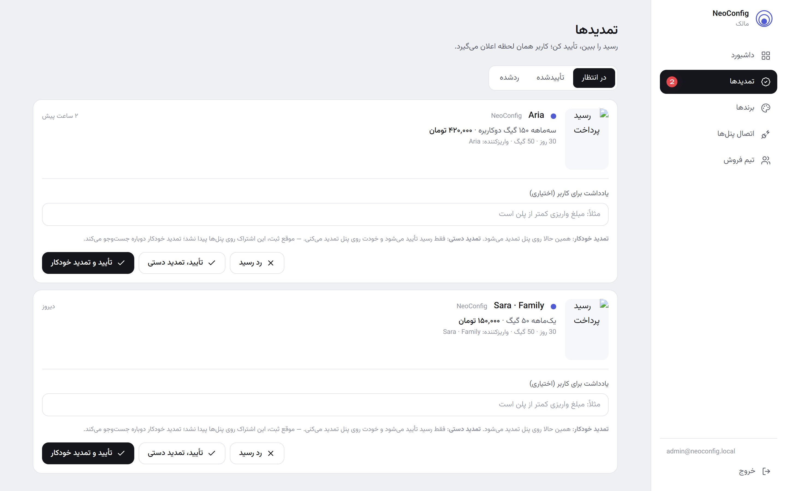</td>
<td width="50%">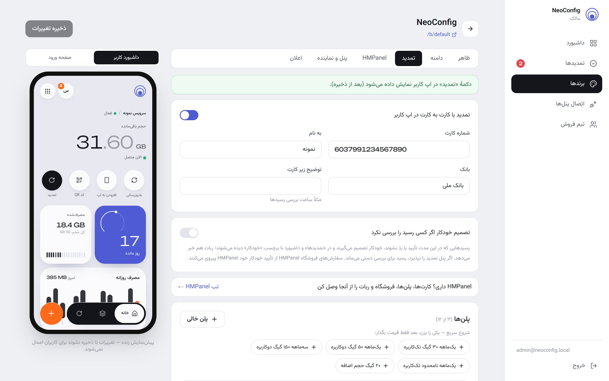</td>
</tr>
<tr>
<td align="center"><sub>رسیدها: تمدید خودکار یا دستی، رد با علت</sub></td>
<td align="center"><sub>پلن‌ها: قالب آماده، دسته‌بندی، نوع سرویس، پیش‌نمایش</sub></td>
</tr>
</table>

- **داشبورد** — فروش ماه، تمدیدها و استعلام‌های روزانه، اشتراک‌های فعال، چک‌لیست راه‌اندازی هر برند
- **رسیدها** — نشانگر زنده در منو، تأیید + تمدید خودکار یا دستی، **تصمیم خودکار** بعد از چند دقیقه
- **برندها** — لوگو برای پوستهٔ روشن و تیره، رنگ، پوسته‌ها، متن صفحهٔ اول و معرفی، دامنه با SSL خودکار، پیش‌نمایش زندهٔ گوشی
- **ربات تلگرام** — رسید با عکس، وضعیت حساب قبل و بعد از تمدید، تشخیص رسید تکراری، دکمه‌های تأیید/رد و دلیل‌های آماده، `/pending` و `/stats`
- **تیم فروش** — نماینده فقط برندهای خودش را می‌بیند

<p align="center">
  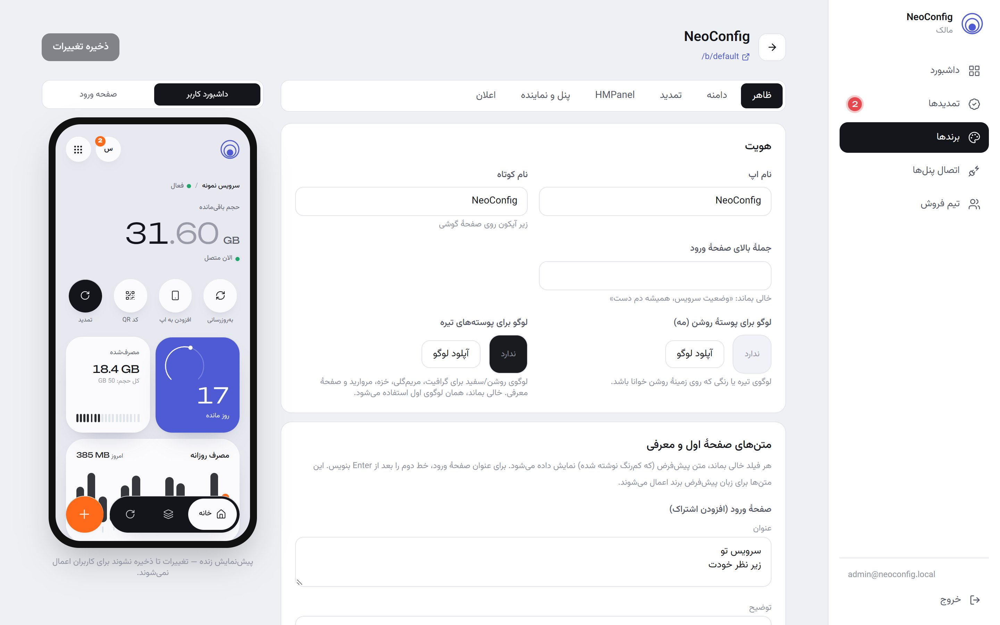
</p>

## ◈ HMPanel

با یک کلید API از HMPanel، برند به همان ادمین وصل می‌شود:

| | |
|---|---|
| **کاربران** | لینک‌های HMPanel و subId های ثنایی پشت آن پیدا می‌شوند |
| **تمدید** | از سهمیه و اعتبار همان ادمین؛ اینباندها دست نمی‌خورند |
| **فروشگاه و ربات** | رسید به‌صورت سفارش در فروشگاه HMPanel ثبت و با ربات HMPanel تأیید می‌شود |
| **کارت‌ها** | از فروشگاه خوانده می‌شوند؛ تغییر آنجا، اینجا هم اعمال می‌شود |
| **پلن‌ها** | محصولات فروشگاه با دسته‌بندی و نوع سرویس؛ قیمت و حجم همگام |
| **دسته‌بندی** | هر سرویس فقط با پلن‌های دسته‌بندی خودش تمدید می‌شود |
| **خرید جدید** | از داخل اپ؛ سرویس ساخته‌شده خودکار به اپ مشتری اضافه می‌شود |

سرویس‌هایی که فروشگاه HMPanel نفروخته، خودکار در NeoConfig بررسی و از طریق API کاربران HMPanel تمدید می‌شوند.

## ⚑ نصب در یک دقیقه

روی **Ubuntu 22.04 / 24.04** یا **Debian 12**، با کاربر root:

```bash
bash <(curl -fsSL https://raw.githubusercontent.com/neoauroraproject/NeoConfig/main/install.sh)
```

- **بدون Docker و بدون کامپایل** — نسخهٔ آماده (حدود ۷۰ مگابایت) از Releases دانلود می‌شود
- **systemd + nginx + PostgreSQL** روی خود سرور؛ گواهی Let's Encrypt با acme.sh (و ZeroSSL به‌عنوان جایگزین)
- رکورد A دامنه را قبل از نصب به IP سرور بزنید (در Cloudflare حالت DNS only)

### منوی `neoconfig`

| | |
|---|---|
| `Status` · `Diagnose` · `Logs` | وضعیت، عیب‌یابی کامل (DNS، پورت، فایروال، گواهی) و لاگ زنده |
| `Update` · `Roll back` | به‌روزرسانی با پشتیبان‌گیری و برگشت خودکار در صورت خطا |
| `Certificates` | `neoconfig ssl add <domain>` |
| `Change admin password` · `Change main domain` | |
| `Back up database` · `Uninstall` | پشتیبان در `/opt/neoconfig/backups` |

## ⚙ فنی

<table>
<tr>
<td valign="top" width="50%">

**پشته**
- Next.js 15 · React 19 · Tailwind · Framer Motion
- NestJS · Prisma · PostgreSQL · Web Push
- systemd · nginx · acme.sh
- 3x-ui (2.x / 3.x) · PasarGuard · HMPanel

</td>
<td valign="top" width="50%">

**امنیت**
- اطلاعات پنل و لینک‌ها با AES-GCM رمزنگاری می‌شوند و به مرورگر نمی‌رسند
- محافظت SSRF پیش از هر واکشی لینک کاربر
- وب‌هوک تلگرام با توکن مخفی و بررسی گروه
- API هیچ‌وقت دسترسی root ندارد؛ گواهی‌ها با سرویس جدا

</td>
</tr>
</table>

<details>
<summary><b>جست‌وجوی اشتراک چطور کار می‌کند؟</b></summary>

1. برند از روی دامنه (یا `/b/slug`) پیدا می‌شود.
2. از لینک، **subId** (ثنایی) یا **توکن** (پاسارگارد / HMPanel) برداشته می‌شود — دامنهٔ لینک مهم نیست.
3. در پنل‌های همان برند جست‌وجو می‌شود: ثنایی ۲.x از `inbounds/list`، ثنایی ۳.x از `clients/list`، پاسارگارد از توکن، HMPanel از `/v1/clients/lookup`.
4. اگر در هیچ پنلی نبود، از خود لینک خوانده می‌شود (هدر `subscription-userinfo` و نام کانفیگ).

</details>

<details>
<summary><b>توسعهٔ محلی</b></summary>

```bash
docker compose up -d db
npm install && npm run db:generate
cd apps/api && npx prisma migrate deploy && cd ../..
npm run dev:api   # :4000
npm run dev:web   # :3000
```

- پیش‌نمایش با دادهٔ نمونه: `/demo?theme=pearl&sample=1`
- اسکرین‌شات‌های همین صفحه: `node --experimental-websocket scripts/screenshots.mjs`
- تست‌ها: `npm test`

</details>

<details>
<summary><b>انتشار نسخهٔ جدید</b></summary>

```bash
git tag v1.0.11 && git push origin v1.0.11
```

GitHub Actions نسخهٔ amd64 و arm64 را می‌سازد؛ سرورها با `neoconfig update` می‌گیرند.

</details>

| مستندات | |
|---|---|
| [DEPLOYMENT](docs/DEPLOYMENT.md) | استقرار |
| [SECURITY](docs/SECURITY.md) | امنیت |
| [TROUBLESHOOTING](docs/TROUBLESHOOTING.md) | رفع اشکال |
| [API-MAPPING](docs/API-MAPPING.md) | نگاشت API پنل‌ها |

</div>

<br />

<div align="center">
  <sub>NeoConfig · ساخته‌شده برای فروشنده‌هایی که می‌خواهند اپ خودشان را داشته باشند</sub>
</div>
