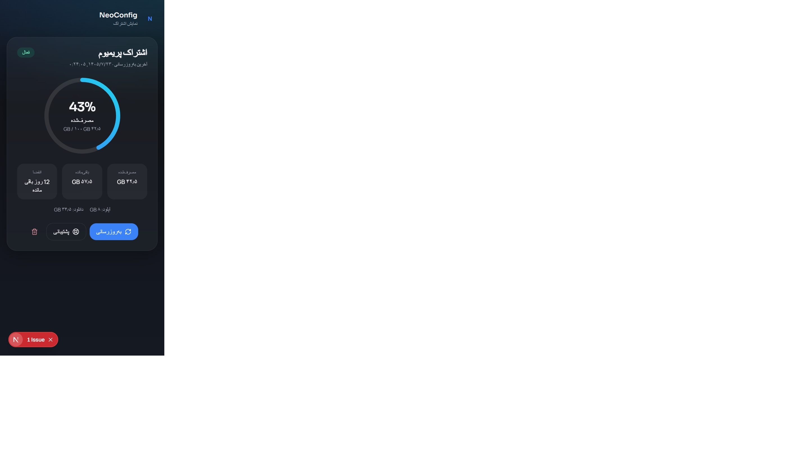
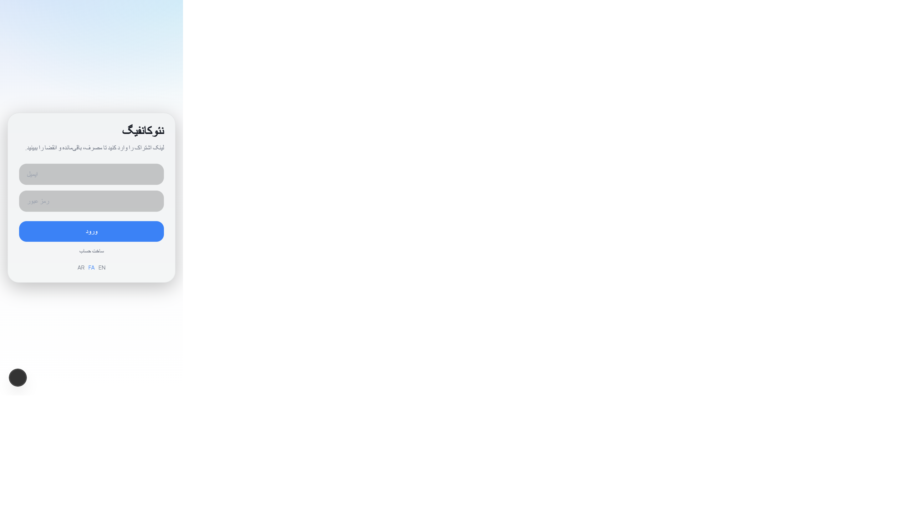
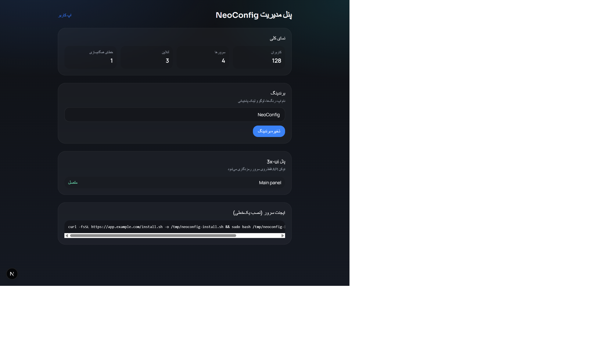

<div align="center">

# NeoConfig

### نمایشگر اشتراک VPN — مینیمال، وایت‌لیبل، قابل نصب روی موبایل

اپلیکیشنی که لینک اشتراک را می‌گیرد و **وضعیت، مصرف ترافیک، باقی‌مانده و تاریخ انقضا** را در یک صفحهٔ تمیز موبایلی نشان می‌دهد.

[نصب سریع](#-راه‌اندازی-سریع) · [اسکرین‌شات](#-اسکرین‌شات) · [نصب یک‌خطی ایجنت](#-نصب-یک‌خطی-ایجنت-لینوکس) · [مستندات](docs/)

</div>

---

## چرا NeoConfig؟

بیشتر پنل‌ها پیچیده هستند. کاربر نهایی فقط می‌خواهد بداند:

- اشتراکش **فعال** است یا نه
- چقدر ترافیک **مصرف** کرده
- چقدر **باقی مانده**
- کی **منقضی** می‌شود

NeoConfig دقیقاً همین را می‌دهد — بدون منوهای اضافه. تنظیمات پیشرفته فقط در **پنل ادمین** است.

| برای کاربر | برای ادمین |
|---|---|
| یک کارت اشتراک زیبا | برندینگ وایت‌لیبل |
| PWA قابل نصب روی گوشی | اتصال امن به 3x-ui |
| فارسی / انگلیسی / عربی | ثبت سرور با نصب یک‌خطی |
| رفرش واقعی از بک‌اند | Audit و سلامت همگام‌سازی |

---

## اسکرین‌شات

<p align="center">
  
  &nbsp;
  
  &nbsp;
  
</p>

| | |
|---|---|
|  | صفحهٔ اصلی — وضعیت، مصرف، باقی‌مانده، انقضا |
|  | ورود / ثبت‌نام با پشتیبانی RTL |
|  | مدیریت برندینگ، پنل 3x-ui و ایجنت |

> پیش‌نمایش زندهٔ UI بدون بک‌اند: مسیر `/demo`

---

## قابلیت‌ها

### اپ کاربر
- افزودن لینک اشتراک و پیش‌نمایش اطلاعات
- نمایش وضعیت: فعال / به‌زودی منقضی / منقضی / غیرفعال / نامشخص
- مصرف آپلود و دانلود، سهمیه و باقی‌مانده (بدون جعل عدد برای مقدار نامشخص)
- رفرش واقعی؛ در خطا دادهٔ قبلی با برچسب «آخرین همگام‌سازی» نگه داشته می‌شود
- PWA: manifest، Service Worker، نصب روی موبایل، حالت آفلاین امن
- چندزبانه: **فارسی · English · العربية** با RTL/LTR

### پنل ادمین
- برندینگ (نام، رنگ، لوگو، پشتیبانی)
- اتصال 3x-ui با توکن API (رمزنگاری‌شده در سرور)
- ثبت سرور و تولید دستور نصب یک‌خطی
- وضعیت اختیاری HMPanel (تا وقتی API واقعی پیکربندی نشود، تمدید نشان داده نمی‌شود)
- نمای کلی سلامت و لاگ audit

### امنیت
- توکن پنل و لینک اشتراک هرگز به مرورگر نمی‌روند
- رمزنگاری AES-GCM در حالت سکون
- محافظت SSRF برای واکشی لینک اشتراک
- ایزولاسیون چندمستأجری در سطح دیتابیس
- ایجنت فقط outbound؛ بدون شل از راه دور

---

## اتصال 3x-ui

پیاده‌سازی بر اساس OpenAPI موجود در [`docs/api310.json`](docs/api310.json):

| نیاز | Endpoint مستند |
|---|---|
| احراز هویت | Bearer API Token یا `POST /login` |
| ترافیک | `GET /panel/api/clients/traffic/{email}` |
| کلاینت | `GET /panel/api/clients/get/{email}` |
| لیست | `GET /panel/api/clients/list` |
| اطلاعات ساب | `GET /{subPath}{subid}?format=info` |

جزئیات نگاشت فیلدها: [`docs/API-MAPPING.md`](docs/API-MAPPING.md)

---

## پشته فنی

- **Frontend:** Next.js 15 · React · TypeScript · Tailwind · Framer Motion · PWA
- **Backend:** NestJS · Prisma · PostgreSQL · JWT · Zod
- **Agent:** باینری Go + `install.sh` + systemd
- **Deploy:** Docker Compose

---

## راه‌اندازی سریع

### با Docker

```bash
cp .env.example .env
# مقادیر JWT_SECRET و ENCRYPTION_KEY را عوض کنید
docker compose up -d --build
```

- اپ: http://localhost:3000  
- API: http://localhost:4000  
- Swagger: http://localhost:4000/api/docs  

### توسعهٔ محلی

```bash
docker compose up -d db
npm install
npm run db:generate
cd apps/api && npx prisma migrate deploy && cd ../..
npm run dev:api   # پورت 4000
npm run dev:web   # پورت 3000
```

تست‌ها:

```bash
npm test
```

---

## نصب یک‌خطی ایجنت (لینوکس)

از **Admin → Server agent** یک توکن یک‌بارمصرف بگیرید:

```bash
curl -fsSL https://APP_DOMAIN/install.sh -o /tmp/neoconfig-install.sh \
  && sudo bash /tmp/neoconfig-install.sh --token 'TOKEN'
```

این دستور:

1. باینری `neoconfig-agent` را دانلود می‌کند  
2. توکن را redeem می‌کند  
3. سرویس systemd را فعال می‌کند  

**توکن ادمین پنل 3x-ui هرگز داخل این دستور نیست.**  
در پروداکشن چکسام را با `NEOCONFIG_AGENT_SHA256` پین کنید.

ساخت باینری:

```bash
cd agent
GOOS=linux GOARCH=amd64 go build -o ../dist/releases/1.0.0/neoconfig-agent-linux-amd64 ./cmd/agent
GOOS=linux GOARCH=arm64 go build -o ../dist/releases/1.0.0/neoconfig-agent-linux-arm64 ./cmd/agent
```

---

## ساختار پروژه

```
apps/web     → اپ کاربر + پنل ادمین (Next.js PWA)
apps/api     → بک‌اند NestJS + ادapter سه‌ایکس‌یوآی
agent/       → ایجنت Go
scripts/     → install.sh
docs/        → مستندات، API mapping، اسکرین‌شات
```

---

## مستندات بیشتر

| فایل | موضوع |
|---|---|
| [docs/DEPLOYMENT.md](docs/DEPLOYMENT.md) | استقرار |
| [docs/SECURITY.md](docs/SECURITY.md) | امنیت |
| [docs/TROUBLESHOOTING.md](docs/TROUBLESHOOTING.md) | رفع اشکال |
| [docs/API-MAPPING.md](docs/API-MAPPING.md) | نگاشت API پنل |
| [docs/api310.json](docs/api310.json) | قرارداد OpenAPI سه‌ایکس‌یوآی |

---

## وضعیت یکپارچه‌سازی

| مورد | وضعیت |
|---|---|
| UI کاربر + PWA | پیاده‌سازی شده |
| بک‌اند امن | پیاده‌سازی شده |
| ادapter 3x-ui (طبق docs) | پیاده‌سازی + تست واحد |
| ایجنت باینری لینوکس | ساخته شده |
| تست روی پنل واقعی 3x-ui | نیاز به دسترسی پنل |
| تمدید HMPanel | Adapter آماده؛ تا پیکربندی واقعی غیرفعال |

---

## لایسنس

برای استفادهٔ خصوصی / تجاری طبق نیاز پروژه‌تان تنظیم کنید.

---

<div align="center">
<sub>ساخته‌شده برای تجربه‌ای ساده از اشتراک — نه یک پنل پیچیدهٔ دیگر.</sub>
</div>
