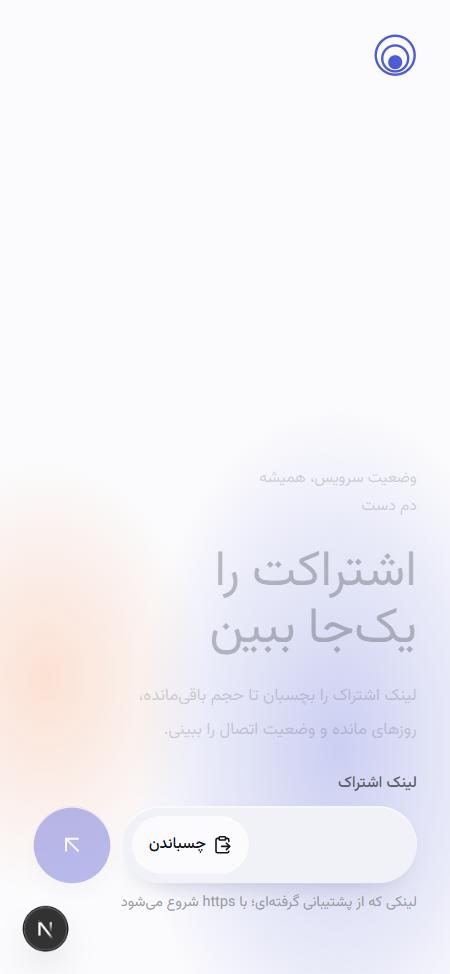
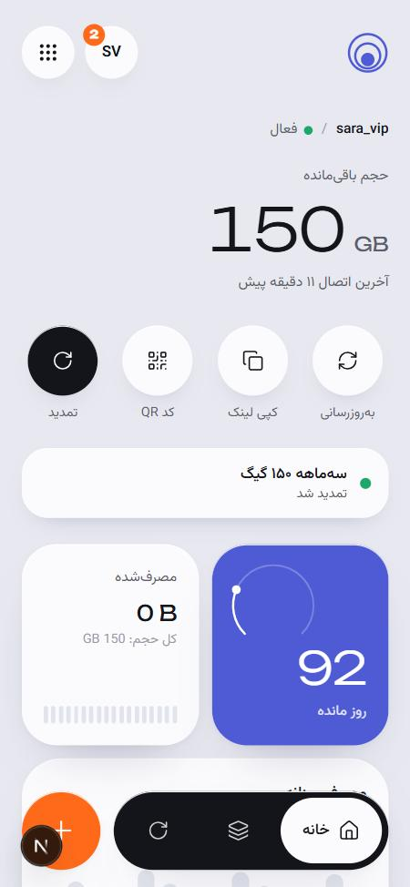
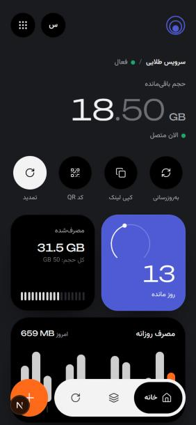
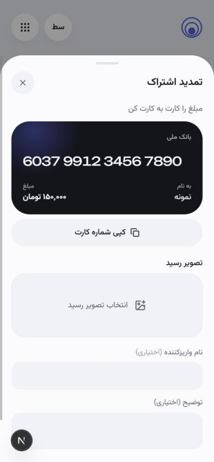

<div align="center">

# NeoConfig

### اپ استعلام اشتراک VPN — وایت‌لیبل، چندبرندی، قابل نصب روی گوشی

کاربر لینک اشتراک ثنایی (3x-ui) یا پاسارگارد را می‌زند و حجم باقی‌مانده، روزهای مانده و وضعیت اتصال را در یک اپ موبایلی تمیز می‌بیند؛ همان‌جا هم می‌تواند با کارت به کارت تمدید کند.

</div>

<p align="center">
  
  
  
  
</p>

---

## برای چه کسی؟

| نقش | چه می‌بیند |
|---|---|
| **کاربر نهایی** | اپ PWA با نام و رنگ برند فروشنده؛ چند اشتراک روی یک گوشی؛ تمدید و اعلان |
| **مالک / مدیر** | برندها، دامنه‌ها، اتصال پنل‌های ثنایی و پاسارگارد، تیم فروش، رسیدها |
| **نماینده فروش** | فقط برندهای خودش: ظاهر، کارت، پلن‌ها و رسیدهای تمدید (بدون دسترسی به پنل‌ها) |

## قابلیت‌ها

### اپ کاربر
- ورود با یک فیلد: لینک اشتراک (با دکمهٔ «چسباندن»)؛ بعد از آن کاربر در حسابش می‌ماند
- **چند اشتراک** روی یک دستگاه، با تغییر نام و حذف؛ همه‌چیز فقط روی همان گوشی ذخیره می‌شود
- حجم باقی‌مانده، روزهای مانده (دایره‌ای)، مصرف/کل، آپلود/دانلود، تاریخ انقضا (شمسی)، آنلاین بودن
- نمودار **مصرف روزانه** که از روی بازدیدهای کاربر روی همان دستگاه ساخته می‌شود
- کپی لینک و **کد QR** برای افزودن اشتراک روی دستگاه دیگر
- **تمدید**: انتخاب پلن ← کارت به کارت ← آپلود رسید ← پیگیری وضعیت
- **اعلان پوش** وقتی تمدید تأیید یا رد شد، و اطلاعیه‌های برند
- نصب PWA با manifest و آیکون اختصاصی هر برند؛ راهنمای نصب برای آیفون
- فارسی (راست‌به‌چپ) و انگلیسی؛ سه پوسته: **مه**، **گرافیت**، **مریم‌گلی**

### پنل مدیریت (`/admin`)
- **داشبورد**: تمدیدهای در انتظار، تمدیدهای ماه، نمودار استعلام روزانه (پیدا شد / نشد)، سلامت پنل‌ها
- **برندها**: نام، لوگو، رنگ، پوسته، پشتیبانی تلگرام، با **پیش‌نمایش زندهٔ گوشی** کنار فرم
- **دامنه‌ها**: هر برند چند دامنه؛ بررسی DNS و HTTPS؛ گواهی SSL خودکار
- **اتصال پنل‌ها**: ثنایی (3x-ui) با نام کاربری/رمز یا توکن API، PasarGuard، و HMPanel با کلید API هر نماینده؛ تست اتصال با تعداد کاربر و آنلاین
- **تمدیدها**: دیدن رسید، تأیید با «تمدید خودکار روی پنل» یا رد با یادداشت؛ کاربر فوراً اعلان می‌گیرد و تیم فروش در تلگرام باخبر می‌شود
- **تیم فروش**: ساخت حساب نماینده و سپردن برند به او
- **اعلان همگانی** برای کاربران یک برند

## جست‌وجوی اشتراک چطور کار می‌کند؟

1. برند از روی دامنه (یا مسیر `/b/slug`) پیدا می‌شود.
2. از لینک اشتراک، **subId** (ثنایی) یا **توکن** (پاسارگارد) استخراج می‌شود.
3. در پنل‌های همان برند (یا همهٔ پنل‌ها) جست‌وجو می‌شود:
   - **3x-ui**: `inbounds/list` ← همهٔ کلاینت‌های هم‌subId جمع زده می‌شوند (مثل صفحهٔ ساب خود پنل)؛ وضعیت آنلاین از `inbounds/onlines`
   - **PasarGuard**: توکن رمزگشایی می‌شود (شناسه یا نام کاربری) ← `GET /api/user/by-id/{id}`
4. اگر در هیچ پنلی نبود، از خود لینک خوانده می‌شود (`?format=info`، `/info`، یا هدر `subscription-userinfo`).

**تمدید خودکار روی پنل**: انقضا از تاریخ فعلی (یا امروز، اگر گذشته) به اندازهٔ روزهای پلن جلو می‌رود، حجم روی مقدار پلن تنظیم و مصرف صفر می‌شود.

## نصب روی سرور (یک خط)

روی **Ubuntu 22.04 / 24.04** یا **Debian 12**، با کاربر root:

```bash
bash <(curl -fsSL https://raw.githubusercontent.com/neoauroraproject/NeoConfig/main/install.sh)
```

- بدون Docker و بدون کامپایل روی سرور: نسخهٔ آماده (Node + API + وب، حدود ۷۰ مگابایت) از GitHub Releases دانلود می‌شود.
- API و وب سرویس‌های systemd هستند، دیتابیس PostgreSQL روی خود سرور، و nginx جلوی آن‌ها.
- گواهی Let's Encrypt دامنهٔ اصلی همان موقع نصب با **acme.sh** گرفته می‌شود و خودکار تمدید می‌شود. اگر نشد، دلیلش همان‌جا نوشته می‌شود و سایت روی HTTP بالا می‌ماند.
- نصب قبلی Docker (اگر باشد) خودکار منتقل می‌شود: دیتابیس، کلیدهای رمزنگاری و تنظیمات.

قبل از نصب، رکورد A دامنه را به IP سرور بزنید (در Cloudflare حالت DNS only).

### منوی مدیریت `neoconfig`

| گزینه | کار |
|---|---|
| Status | وضعیت سرویس‌ها و دامنه‌ها |
| Diagnose | بررسی سرویس‌ها، DNS، پورت‌ها، فایروال، گواهی و HTTPS |
| Logs | لاگ زنده (api / web / nginx / ssl) |
| Update | دانلود نسخهٔ جدید، پشتیبان‌گیری، اجرای مایگریشن‌ها؛ اگر نسخهٔ جدید بالا نیاید، خودکار برمی‌گردد |
| Change admin password | تغییر رمز (و ایمیل) مدیر؛ همهٔ نشست‌ها خارج می‌شوند |
| Change main domain | دامنهٔ جدید + گواهی |
| Certificates | فهرست گواهی‌ها و صدور/تمدید: `neoconfig ssl add <domain>` |
| Back up database | پشتیبان در `/opt/neoconfig/backups` (۱۰ نسخهٔ آخر) |
| Roll back | برگشت به نسخهٔ قبلی |
| Uninstall | حذف کامل، با نگه داشتن پشتیبان |

### دامنهٔ برندها

در پنل ادمین ← برندها ← دامنه، دامنه را اضافه کنید. API فقط یک درخواست در صف می‌گذارد؛ سرویس جدای `neoconfig-ssl` با دسترسی root اول از API می‌پرسد که دامنه واقعاً متعلق به یک برند است، بعد گواهی می‌گیرد و nginx را تنظیم می‌کند. خود API هیچ‌وقت دسترسی root ندارد.

### انتشار نسخهٔ جدید

```bash
git tag v1.0.1 && git push origin v1.0.1
```

GitHub Actions نسخهٔ آماده را برای amd64 و arm64 می‌سازد و در Releases می‌گذارد؛ سرورها با `neoconfig update` آن را می‌گیرند.

## اتصال به HMPanel

1. در HMPanel ← **دسترسی API** یک کلید بسازید (کلید هر نماینده فقط مشتری‌های همان نماینده را می‌بیند؛ مالک می‌تواند برای هر نماینده کلید بسازد).
2. در NeoConfig ← **اتصال پنل‌ها** ← **HMPanel**: آدرس HMPanel و کلید `hmp_…`.

لینک‌های اشتراک HMPanel (`https://panel/s/<token>`) و subId های ثنایی پشت آن پیدا می‌شوند و «تمدید خودکار روی پنل» از طریق API خود HMPanel انجام می‌شود (همان سقف‌ها و کسر اعتبار پنل). مستندات API: `docs/admin-api.md` در مخزن HMPanel.

## اعلان تمدید در تلگرام

در «برندها ← اعلان»: توکن ربات (از @BotFather) و آیدی گروه/کانال را وارد کنید و «ارسال پیام آزمایشی» را بزنید. هر رسید تازه همراه تصویرش، و هر تأیید یا رد (با نام تأییدکننده)، به همان گروه می‌رود. هر برند/نماینده می‌تواند ربات و گروه خودش را داشته باشد. اگر سرور به تلگرام دسترسی ندارد، `TELEGRAM_API_BASE` را روی یک رله تنظیم کنید.

## توسعهٔ محلی

```bash
docker compose up -d db   # فقط دیتابیس برای توسعه
npm install
npm run db:generate
cd apps/api && npx prisma migrate deploy && cd ../..
npm run dev:api   # :4000
npm run dev:web   # :3000  (‎/api/v1 به API ریدایرکت می‌شود)
```

- پیش‌نمایش بدون پنل و با دادهٔ نمونه: `/demo` (پوسته‌ها: `/demo?theme=graphite`، `/demo?theme=sage`)
- برای وصل کردن پنل روی localhost یا شبکهٔ داخلی: `ALLOW_PRIVATE_PANELS=true`

```bash
npm test
```

## پشته فنی

**Frontend:** Next.js 15 · React 19 · Tailwind · Framer Motion · PWA + Web Push  
**Backend:** NestJS · Prisma · PostgreSQL · JWT · web-push  
**سرور:** systemd · nginx · acme.sh (Let's Encrypt) · PostgreSQL  
**Panels:** 3x-ui (ثنایی) · PasarGuard · HMPanel

## امنیت

- رمز/توکن پنل‌ها و لینک‌های اشتراک با AES-GCM رمزنگاری می‌شوند و هرگز به مرورگر نمی‌روند
- محافظت SSRF پیش از هر واکشی لینک کاربر
- نماینده‌ها فقط به برندهای خودشان دسترسی دارند؛ مدیریت پنل‌ها فقط برای مالک و مدیر
- رسیدها حداکثر ۳ مگابایت، فقط تصویر، و فقط برای ادمین همان برند قابل مشاهده

## مستندات

| فایل | موضوع |
|---|---|
| [docs/DEPLOYMENT.md](docs/DEPLOYMENT.md) | استقرار |
| [docs/SECURITY.md](docs/SECURITY.md) | امنیت |
| [docs/TROUBLESHOOTING.md](docs/TROUBLESHOOTING.md) | رفع اشکال |
| [docs/API-MAPPING.md](docs/API-MAPPING.md) | نگاشت API پنل |
